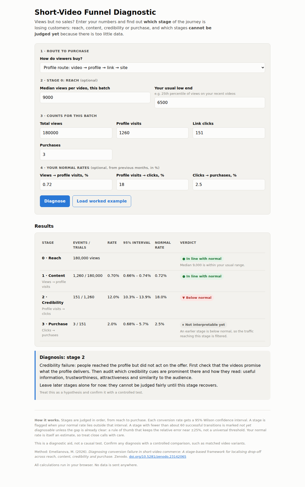

# Short-Video Funnel Diagnostic

**Views but no sales?** This small tool shows *which stage* of the short-video customer journey is losing people (reach, content, credibility or purchase) and which stages *cannot be judged yet* because there is too little data.

**Try it:** open `index.html` in a browser, or use the hosted version on GitHub Pages: https://mashaemelianova.github.io/short-video-funnel-diagnostic/

It is the practical companion to the research paper:

> Emelianova, M. (2026). *Diagnosing conversion failure in short-video commerce: A stage-based framework for localising drop-off across reach, content, credibility and purchase.* Zenodo. https://doi.org/10.5281/zenodo.23142065

## What it does

You enter, for one batch of videos:

| Input | Example |
|---|---|
| Route to purchase | profile → link → site, in-app product card, or comment/DM |
| Total views | 180,000 |
| Arrivals on the next surface | 1,260 profile visits |
| Actions on the offer | 151 link clicks |
| Purchases | 3 |
| Your normal rates (optional) | 0.72% · 18% · 2.5% |

The tool then:

1. **Judges stages in order**, from reach to purchase. A later stage is not judged while an earlier one is below normal, because the traffic reaching it is filtered.
2. **Puts an uncertainty band on every rate** (95% Wilson interval) and flags a stage when your normal rate lies outside it.
3. **Marks stages as "not yet diagnosable"** when they have fewer than about 60 successful transitions, unless the gap is already clear. This is a rule of thumb that keeps the relative error near ±25%, not a universal threshold.
4. **Gives a remediation direction** for the stage it identifies, based on the paper.

In the worked example, the headline "3 sales from 180,000 views" turns out to be a **credibility** problem in the middle of the journey, while the purchase stage, the one most teams redesign first, cannot be judged yet.

## The four stages

| Stage | Failure | What it looks like |
|---|---|---|
| 0 | Reach | The platform showed the videos to fewer people than usual |
| 1 | Content | People watched but did not move on to the profile, product card or conversation |
| 2 | Credibility | People arrived but did not act on the offer |
| 3 | Purchase | People started to buy but did not finish |

## Limits

- It is a **diagnostic aid, not a causal test**. Confirm a diagnosis with a controlled comparison, for example matched video variants.
- Your normal rate is itself an estimate with its own uncertainty, so treat close calls with care.
- Purchases made later, on another device or through search are not counted, so the purchase stage is usually understated.

## Privacy

Everything runs in your browser. No data is stored or sent anywhere.

## Citation

If you use this tool or the framework, please cite the paper above. A `CITATION.cff` file is included.

## Licence

MIT © 2026 Maria Emelianova
